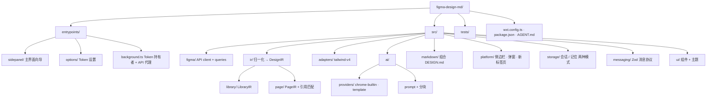
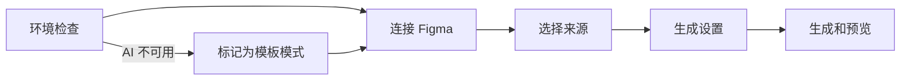

# AGENT.md — Figma → DESIGN.md Browser Extension

> 本文档是项目开发、维护和迭代的依据。任何 AI agent 修改代码前必须先读本文件。

## 1. 项目目标
把 Figma 设计数据转换成精简、标准化、适合 AI agent 使用的 DESIGN.md，减少 token 消耗，并作为后续开发和迭代的设计依据。

## 2. 已确认的决策
| 项 | 决定 |
|---|---|
| 扩展框架 | WXT（Vite 驱动，Manifest V3，可分浏览器构建） |
| 目标浏览器 | v1：Chrome；架构预留 Firefox / Safari / Edge |
| v1 CSS 方案 | Tailwind v4（`@theme`） |
| 模型不可用时 | 提供"模板生成"模式（不调用 AI，只输出 tokens 和结构） |
| 本地模型 | Chrome 内置 Gemini Nano（Prompt API `LanguageModel`） |
| Token 存储 | `@wxt-dev/storage`，用户可选"仅本次会话"或"记住 Token" |
| 设计库 | 两层模式：VI 库生成基础层 `DESIGN.foundation.md`，产品页面生成页面层 `DESIGN.<page>.md`，页面层只引用基础层 |
| PAT scopes | `current_user:read`、`file_content:read`、`file_metadata:read`、`file_versions:read`、`library_content:read`、`library_assets:read`；`file_variables:read` 仅 Enterprise 可见，可选 |
| 版本标记 | 每份 DESIGN.md 记录 Figma 版本；生成前可选版本；用 `/meta` 做过期检测 |
| 状态 | 已确认（2026-11-27）；第一阶段基线见 `branches/stage1-m1/AGENT.md`，v1 之后的需求见 `ROADMAP.md` |

## 3. 核心链路
1. 用户填入 Figma Personal Access Token，并选择保存方式
2. 用户选择生成类型，并粘贴 Figma 链接 → 解析出 `fileKey` 和 `nodeId`：
   - **基础层**：粘贴 VI 库文件链接
   - **页面层**：粘贴产品页面文件或 Frame 链接，可选关联一份已生成的基础层
3. background 用 Token 调 Figma REST API（UI 通过消息请求，不直接接触 Token）：
   - `GET /v1/me`：验证 Token
   - `GET /v1/files/:key/nodes?ids=…`：节点结构
   - `GET /v1/files/:key/styles`：颜色 / 文字 / 效果样式
   - `GET /v1/files/:key/variables/local`：仅 Enterprise；返回 403 时自动降级
   - `GET /v1/files/:key/components`、`/component_sets`：库文件的组件和变体定义
   - `GET /v1/components/:key`、`/v1/styles/:key`（`library_assets:read`）：由页面里的引用 key 追溯到所属库文件
   - `GET /v1/files/:key/meta`（`file_metadata:read`）：轻量获取 `version`、`lastModified`，用于过期检测
   - `GET /v1/files/:key/versions`（`file_versions:read`）：版本历史，供用户选择版本
   - 读文件类接口带 `?version=<id>` 以固定到所选版本
   - 接口和 scope 已于 2026-11-27 按官方文档核实（developers.figma.com/docs/rest-api）：
     `/nodes`、`?version=` → file_content:read；`/meta` → file_metadata:read；`/versions` → file_versions:read；
     `/files/:key/styles|components|component_sets` → library_content:read（必须是主文件 key，分支不行）；
     `/components/:key`、`/component_sets/:key`、`/styles/:key` → library_assets:read；
     `/variables/local` → file_variables:read（仅 Enterprise）
4. 归一化层（纯函数）：Figma JSON → `DesignIR`，分两层：
   - `LibraryIR`：token 名称和分组、数值、组件定义（变体、属性、状态对应的 token）
   - `PageIR`：页面结构、使用了哪些库组件和 token（按名称引用）、本页自定义样式
5. 适配层：`DesignIR` → Tailwind v4 `@theme` 代码 + 安装配置步骤
6. 生成层：通过 `AIProvider` 接口选择
   - `chrome-builtin`：Gemini Nano 写组件描述和使用规则
   - `template`：用固定模板输出，不调用 AI
7. 组合成 DESIGN.md → 预览 / 复制 / 下载
   - 基础层输出 `DESIGN.foundation.md`
   - 页面层输出 `DESIGN.<page>.md`，只引用基础层的 token 和组件名，不重复写数值

## 3.1 设计库两层模式
- **引用解析**：页面节点上的样式和组件实例带有库 key；通过 key 找到库文件，读取 token 名称和组件定义
- **匹配规则**：页面层的数值能匹配基础层 token 时，写 token 名；匹配不上的标成"本页自定义"，提示偏离规范
- **版本标记**：
  - Meta 记录 `version_id`、`version_label`（设计师命名的版本，没有则为空）、`last_modified`、`generated_at`
  - 生成前可选版本：默认"最新"，也可选设计师命名过的版本；基础层建议固定到正式发布版
  - 页面层记录它引用的基础层 `version_id`
- **过期检测**：打开插件或关联基础层时调用 `/meta` 比较 `version`；不一致则提示"已更新到 X，当前基于 Y"，并提供重新生成
- **降级**：
  - 没有库文件权限 → 只用节点上的实际数值，token 名自动生成，并提示用户
  - 未关联基础层 → 页面层退化为独立文档（包含数值）
- **v1 范围**：组件行为只覆盖变体和状态（例如 Hover / Disabled 对应的 token）；Prototype 交互逻辑暂不支持

## 4. 环境门槛（仅对 chrome-builtin provider）
- Chrome 版本 ≥ `MIN_CHROME_VERSION`（暂定 138，M4 前用 context7 / 官方文档核实）
- `LanguageModel.availability()`：
  - `available`：启用 AI 模式
  - `downloadable` / `downloading`：引导下载，显示进度
  - `unavailable`、版本不够或 API 不存在（如 Firefox / Safari）：自动用 `template` provider，并显示原因

## 5. 安全与存储
- 所有存储读写统一通过 `src/storage/`（基于 `@wxt-dev/storage`），禁止直接调用 `chrome.storage`
- 两种保存方式：
  - **仅本次会话**：`session:` 存储（内存，关闭浏览器即清空）
  - **记住 Token**：`local:` 存储（不加密，写清楚提示）
- Token 只在 background 读取和使用；UI 只能拿到"已连接 / 用户名 / 过期提醒"等状态
- 不使用 content script；不申请用不到的权限；`host_permissions` 只包含 `https://api.figma.com/*`
- Token 不写日志、不出现在报错信息里、不发给 Figma 以外的任何地方
- Token 设置页提供引导：生成**只读权限**且**设置过期时间**的 PAT，scope 清单见第 2 节；验证时若缺少 scope，提示具体缺哪一项
- 一键"断开连接"：清除所有已存 Token 和缓存
- v1 不做本地加密、不做 OAuth（需要后端）；以后如需加，在 `storage/` 内部实现，不影响其他层

## 6. 跨浏览器扩展性
| 功能 | Chrome | Firefox | Safari | 抽象位置 |
|---|---|---|---|---|
| 存储 | 支持 | 支持 | 支持 | `src/storage/` |
| 内置 AI | 支持 | 不支持 | 不支持 | `src/ai/providers/` |
| 侧边栏 | `sidePanel` | `sidebar_action` | 没有 | `src/platform/` |
| 打包 | WXT | WXT | WXT + Xcode 转换 | `wxt.config.ts` |

- 禁止在业务代码中直接使用 `chrome.*`；一律用 WXT 的 `browser` API 或上面的抽象层
- 浏览器差异只能出现在 `src/platform/`、`src/ai/providers/` 和 `wxt.config.ts`
- 新增 AI 来源（Edge 内置模型、用户自填 API 等）= 新增一个 provider，不改其他层
- Safari 没有侧边栏：`platform/` 改用弹窗或新标签页打开同一个向导页

## 7. 技术栈（全部使用最新稳定版）
- pnpm、Vite、React + TypeScript（strict）
- WXT + `@wxt-dev/storage`
- Tailwind CSS v4（插件 UI 和主题）
- TanStack Query（请求、缓存、重试）
- Zod（校验 Figma 返回数据、DesignIR、消息格式）
- react-markdown（预览）
- Vitest（单元测试和快照测试）、ESLint + Prettier

## 8. 开发规范
- 日常开发用 `pnpm dev`（HMR）；`pnpm build` 只用于打包验证和发布；dev 浏览器资料目录由 `web-ext.config.ts` 固定在 `.wxt/chrome-data`
- 归一化层和适配层必须是纯函数，并有快照测试：同样的输入必须得到同样的输出
- 只能把 `DesignIR` 发给 AI，不能发原始 Figma JSON
- 每次调用 AI 前先估算 token（`measureInputUsage`），超出限制就按组件分块
- AI 输出只用于描述性文字；token 数值永远来自代码，不来自 AI
- token 名称和组件名以库文件为准，不能由 AI 生成或改写
- background 和 UI 之间的消息用 Zod 定义类型并校验
- 新增 CSS 方案 = 新增一个 `adapters/*`，不改其他层
- 依赖必须是主流、仍在维护的库；新增依赖前先在本文件登记

## 9. 需要的 Skills / 工具
- **context7 MCP**：查最新文档（WXT、Chrome Built-in AI、Tailwind v4、TanStack Query、Zod）
- Figma REST API 文档（含 PAT scopes）
- Chrome / Firefox / Safari 扩展文档（MV3、sidePanel、sidebar_action、storage）
- 可选：浏览器自动化，用于 E2E 测试

## 10. 项目结构


## 11. 用户流程（4 步向导）

- 第一次使用走完整流程
- 启动时若有已存 Token，先自动调用 `/v1/me` 验证，验证期间只显示加载状态，不渲染连接页：
  - 通过 → 跳过连接页，直接进入"选择来源"
  - 403（过期或撤销）→ 清除 Token，回到连接页并说明原因
  - 断网 / 429 / 5xx → 保留 Token，显示"重试"和"换一个 Token"，不退回连接页
- "连接 Figma"一步包含：保存方式选择、只读 PAT 生成引导、验证结果
- 向导顶部一直显示当前模式（AI / 模板）和连接状态，可随时断开

## 12. DESIGN.md 输出结构
### 12.0 Meta 格式（三种文档通用）
```yaml
source:
  file: VI Library (abc123)
  version_id: "4567890123"
  version_label: "v2.1 品牌色更新"
  last_modified: 2026-11-20T08:30:00Z
foundation:            # 仅页面层
  version_id: "4567890123"
generated_at: 2026-11-27T12:10:00+08:00
css: tailwind-v4
mode: ai | template
```

### 12.1 基础层 `DESIGN.foundation.md`
1. Meta（见 12.0）
2. Design Tokens（带库里的名称和分组）
3. Tailwind v4 `@theme` 配置代码 + 安装步骤
4. 组件规格：变体、属性、各状态对应的 token
5. AI 使用规则：只能使用这里定义的 token 和组件

### 12.2 页面层 `DESIGN.<page>.md`
1. Meta（见 12.0，含 `foundation.version_id`）
2. 页面结构：用了哪些组件（按名称引用）、布局
3. 本页自定义：基础层没有的样式，并标明偏离
4. AI 使用规则：先读基础层，再按本页组合

### 12.3 独立模式（未关联基础层）
1. Meta（见 12.0）
2. Design Tokens：颜色 / 字体 / 间距 / 圆角 / 阴影
3. Tailwind v4 `@theme` 配置代码
4. 安装和配置步骤（pnpm add tailwindcss @tailwindcss/vite …）
5. 组件规格：结构、状态、对应的 token
6. AI 使用规则：agent 开发时必须遵守的约束

## 13. 里程碑
- M1：WXT 脚手架、storage / platform / messaging 抽象、Token 设置、Figma 连接验证
- M2：链接解析、Figma 拉取、版本读取与选择、LibraryIR / PageIR 归一化、库引用追溯、快照测试（代码已完成，待本地验证）
- M3：Tailwind v4 适配器 + template provider 输出（基础层、页面层、独立模式）
- M4：chrome-builtin provider（环境检查、分块、prompt）
- M5：预览 / 复制 / 下载、过期检测提示、UX 打磨、E2E
- 后续：见 `ROADMAP.md`
